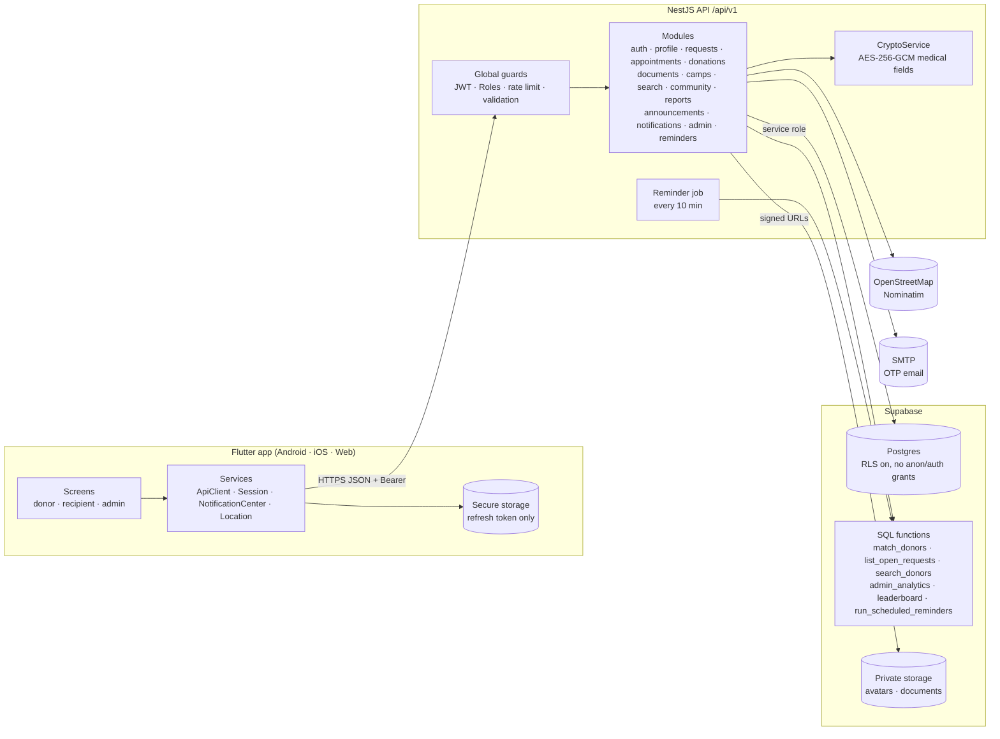
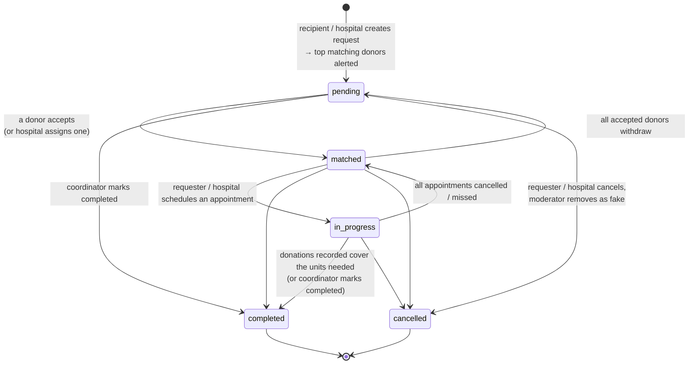
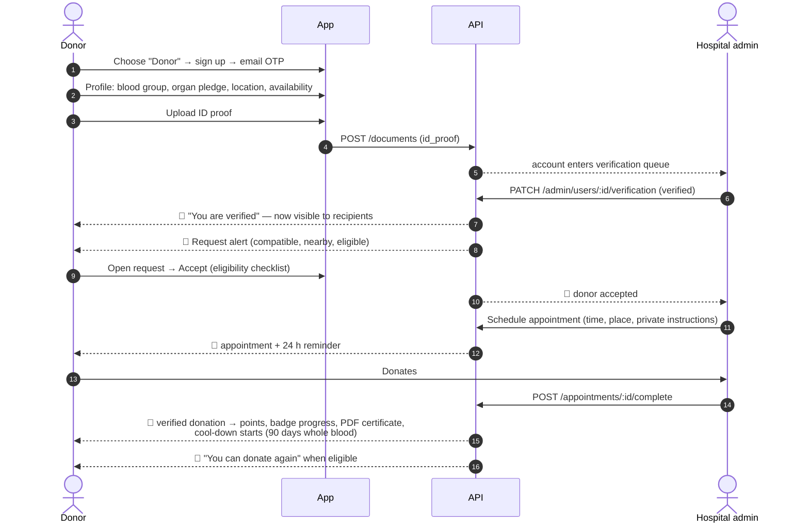
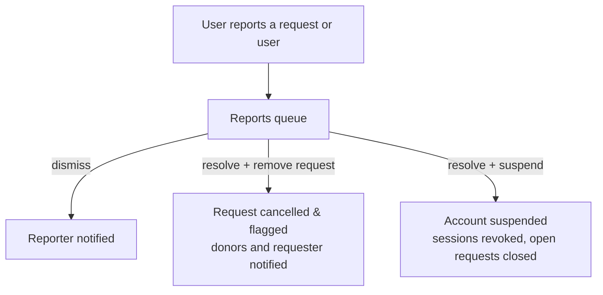

# Life Link — Architecture, flows and spec coverage

This document maps the product spec (*LifeLink App.pdf*) to what is built, and
shows every user journey end to end. Diagrams are Mermaid (rendered by GitHub).

## 1. Architecture



* The app never talks to Supabase directly; the API is the only door.
* Only the refresh token is stored on the device (Keychain / Keystore). All data lives in Postgres.
* Heavy queries (matching, distance, analytics) run in SQL, close to the data.

## 2. Request lifecycle



Every transition is written to `request_events` and shown as the request's **Activity** timeline.
Everyone involved (requester, accepted donors, hospital admins) is notified on each change.

## 3. Donor journey



Also available to donors: book a slot at any hospital (`POST /appointments`, hospital confirms),
camps (register, 24 h reminder), donation history + Excel export, leaderboard, recipient feedback.

## 4. Recipient journey

```mermaid
sequenceDiagram
  autonumber
  actor R as Recipient
  participant App
  participant API
  actor D as Donor
  actor H as Hospital admin
  R->>App: Choose "I need a donor" → sign up → profile (hospital, location)
  R->>App: New request: blood/organ, urgent or scheduled, hospital, location,<br/>optional medical proof
  App->>API: POST /requests
  API-->>D: 🔔 top-scored compatible donors alerted
  API-->>H: 🔔 new request at your hospital → verify it
  H->>API: POST /admin/requests/:id/verify  (✔ verified badge)
  D->>API: Accept
  API-->>R: 🔔 donor accepted (name, blood group, phone)
  R->>App: Status: Pending → Matched; see best matches, invite more donors
  R->>API: Schedule donation (or hospital does)
  Note over R,H: Status: In progress
  H->>API: Record donation
  API-->>R: 🔔 request completed when units are covered
  R->>App: Rate donor(s) and hospital
```

## 5. Admin journeys

**Hospital admin** (scoped to their hospital) — dashboard of work queues:

| Queue | Action |
|---|---|
| ID verifications | Review profile, health declaration and documents → verify / reject with reason |
| Slot requests | Confirm or propose another time for donor bookings |
| Requests to verify | Confirm a request is genuine → verified badge |
| Today's donations | Mark donated (verified donation + certificate) or missed |
| Donations / documents | Verify self-reported donations, review documents |

Plus: post requests for the hospital, alert more donors, assign a donor manually after a phone call,
remove fake requests, manage camps (nearby users notified automatically), announcements, analytics & Excel reports.

**Super admin** (platform-wide): everything above across all hospitals, plus partner-hospital
onboarding, assigning hospital admins, the reports (moderation) queue, and suspending/reinstating users.



## 6. Smart matching

Hard filters (all must hold): email-verified **and identity-verified**, account active, not the requester,
`available_to_donate` (blood) or a pledge for the organ, **blood-compatible** (red-cell rules for blood;
ABO-only for kidney/liver/heart/lung; none for corneas and marrow), within the radius (or same city when
coordinates are missing), hasn't declined.

Score 0–100 = 45·proximity + 25·compatibility + 15·reliability + 15·rating

| Term | Meaning |
|---|---|
| proximity | `1 − distance/radius` (0.3 if distance unknown but same city) |
| compatibility | 1.0 exact group, 0.7 compatible — keeps scarce O− donors for when they're needed |
| reliability | `min(verified donations, 5) / 5` |
| rating | average rating / 5 (0.6 when unrated) |

Eligible donors (past their cool-down) rank first. Alert reach depends on urgency:

| Priority | Radius | Donors alerted |
|---|---|---|
| urgent | 50 km | 100 |
| high | 30 km | 50 |
| medium | 20 km | 25 |
| low | 10 km | 10 |

Each donor is alerted at most once per request (`request_alerts`). Coordinators see the ranked list
("Best-matching donors") and can invite individuals; hospital admins can also assign.

## 7. Spec coverage

✅ built · 🟡 partly / with a stated limitation · ⏳ not built (reason)

### Donor
| Spec item | Status | Where |
|---|---|---|
| Choose Donor role, personal + blood group + organ info | ✅ | Onboarding (role → profile with organ pledge) |
| Upload ID proof, wait for verification | ✅ | Verify identity screen → admin queue |
| Visible to recipients only once verified | ✅ | `search_donors`, `match_donors` filter `verification_status='verified'` |
| Dashboard of requests matching blood type & location | ✅ | Home "Requests you can help with" (compatible, ≤50 km) |
| Accept / decline → status update → recipient & hospital notified | ✅ | `POST /requests/:id/responses` |
| Hospital confirms appointment → donation → completed | ✅ | Appointments; complete records the donation |
| Cool-down (e.g. 90 days) | ✅ | `donor_stats.next_eligible_on`; accept blocked until eligible |
| History, certificate download/share | ✅ | Profile → history, PDF certificate, Excel export |
| Availability toggle | ✅ | Home switch, settings |
| Filter requests by location, type, urgency | ✅ | Requests: "I can donate", type chips, priority ordering, distance |
| Schedule donation appointments | ✅ | "Book a donation" + scheduled appointments |
| Points / certificates per donation | ✅ | 100/verified donation + 20/accepted request |
| Recipient feedback | ✅ | Ratings → profile "Recipient feedback" |
| Reminder for next eligible date, appointment reminders, camp alerts | ✅ | `run_scheduled_reminders` + camp creation alerts |
| Location sharing (optional) | ✅ | "Use my location" (opt-in), saved to profile |
| Push notifications | 🟡 | In-app notifications with 45 s polling and in-app banners; OS push needs a Firebase project (FCM) — see §8 |
| Sign-up via phone or social login | ⏳ | Email + OTP only; phone needs an SMS provider, social needs OAuth apps — see §8 |

### Recipient
| Spec item | Status | Where |
|---|---|---|
| Recipient role, personal info, hospital, location | ✅ | Onboarding (blood group optional, hospital field) |
| Create blood/organ request, urgency, hospital, quantity | ✅ | Create request (Urgent / Scheduled) |
| Medical documents for authenticity | ✅ | Attach proof on request → hospital verifies → badge |
| Notify nearby matching donors | ✅ | Smart matching on create |
| Track Pending → Matched → In progress → Completed | ✅ | Status stepper + activity timeline |
| Donor accepts → real-time alert + donor details | ✅ | Notification + polling banner; donor phone/name/blood group |
| View nearby matching donors | ✅ | "Best-matching donors" + Find donors (compatible) |
| Confirm appointment / hospital schedules | ✅ | Schedule from request page |
| Share pickup details securely | ✅ | Appointment instructions visible only to that donor and coordinators; requester phone hidden until a donor accepts |
| Mark completed / hospital updates | ✅ | Mark completed; auto-complete when units are covered |
| Rate donor / hospital, view donor profile & rating | ✅ | Ratings; public donor profile |

### Admin
| Spec item | Status | Where |
|---|---|---|
| Role-based admin (hospital / super) | ✅ | `hospital_admin`, `super_admin` |
| Review profiles & ID proofs, approve/reject | ✅ | People → To verify |
| Monitor all active requests | ✅ | Admin requests (hospital-scoped / platform) |
| Manually assign donors | ✅ | Assign from best matches |
| Update status (in progress / completed) | ✅ | Scheduling, complete, close |
| Camps with date, venue, capacity on dashboards & map | ✅ | Camps + map pins + nearby alerts |
| Analytics: totals, blood-type availability, region stats, success rate, demand-supply gap | ✅ | Analytics page |
| Weekly/monthly reports | ✅ | Excel export (week / month / quarter / year) |
| Emergency alerts overview | ✅ | Urgent counts, urgent list, alerts sent (7 d) |
| Block suspicious users, handle fake requests | ✅ | Suspend / reinstate, remove request, reports queue |
| Campaigns: drives, notifications, in-app banners | ✅ | Camps + announcements (banner + optional notification) |
| Partner hospital onboarding | ✅ | Partner hospitals (super admin) |
| "Reports from chat interactions" | 🟡 | There is no chat; users report requests/users instead. In-app chat is a separate feature |

### System
| Spec item | Status | Notes |
|---|---|---|
| OTP / email verification | ✅ | 6-digit codes, hashed, 5 attempts, 15 min |
| Encrypted data storage | ✅ | TLS in transit; Supabase encryption at rest; **AES-256-GCM field encryption** for medical free text; private buckets + signed URLs |
| HIPAA/GDPR | 🟡 | Technical controls in place (encryption, least privilege, data export, account deletion, no third-party data sharing). Formal compliance also needs policies, a DPA/BAA with Supabase, audit and retention rules |
| RBAC donor / recipient / admin | ✅ | Roles + per-request coordinator checks |
| Geolocation, smart matching | ✅ | §6 |
| Dark / light theme | ✅ | System / Light / Dark, saved to the account |
| Feedback & rating | ✅ | |
| PDF certificates | ✅ | |
| Leaderboard | ✅ | First name + initial, opt-out |
| Multi-language | ⏳ | See §8 |
| Future scope (gov/hospital DB integration, fitness bands, blood-bank inventory, AI shortage prediction) | ⏳ | Marked "future" in the spec. Badges (gamification) are built |

## 8. Not built, and what it would take

| Feature | Why not now | What it needs |
|---|---|---|
| OS push notifications | Needs your Firebase project credentials (`google-services.json`, APNs key) | Add `firebase_messaging`, a `device_tokens` table and an FCM sender in `NotificationsService.notify` — in-app notifications already flow through one place |
| Phone (SMS OTP) login | Needs an SMS provider account (MSG91 / Twilio) and DLT registration in India | New OTP channel in `OtpService` |
| Google / Apple sign-in | Needs OAuth client IDs | Token exchange endpoint issuing our session |
| Multi-language (English + Hindi/Marathi…) | Every screen's strings must be externalised and translated by a native speaker | `flutter gen-l10n` with ARB files; backend messages via keys |
| In-app chat | Separate real-time feature | Messages table + websocket/realtime channel; moderation hooks already exist (reports) |
| Real-time (sub-second) updates | Polling every 45 s is used | Supabase Realtime or websocket gateway |
